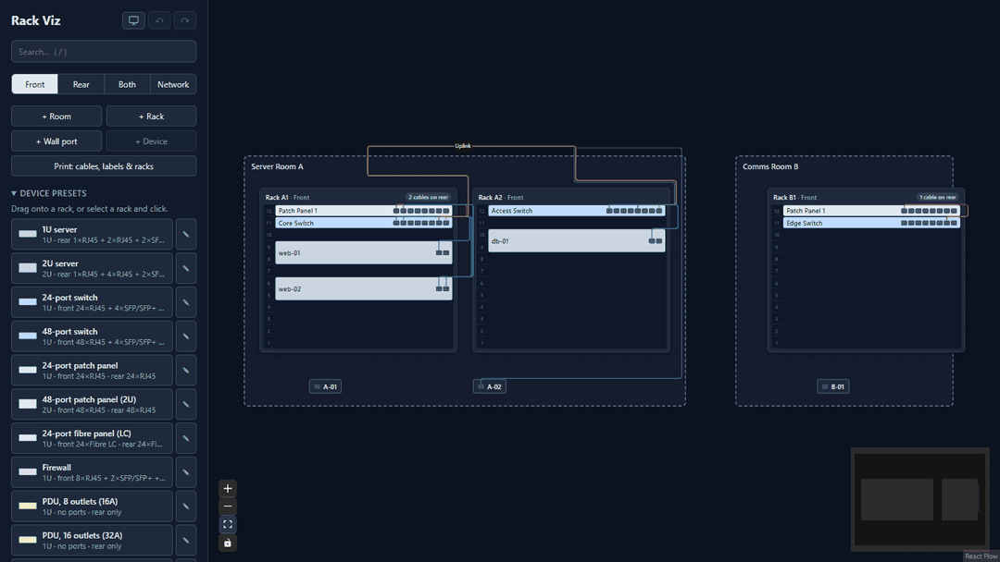
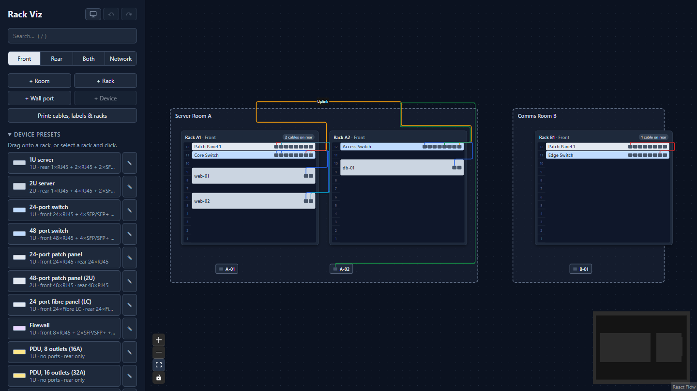
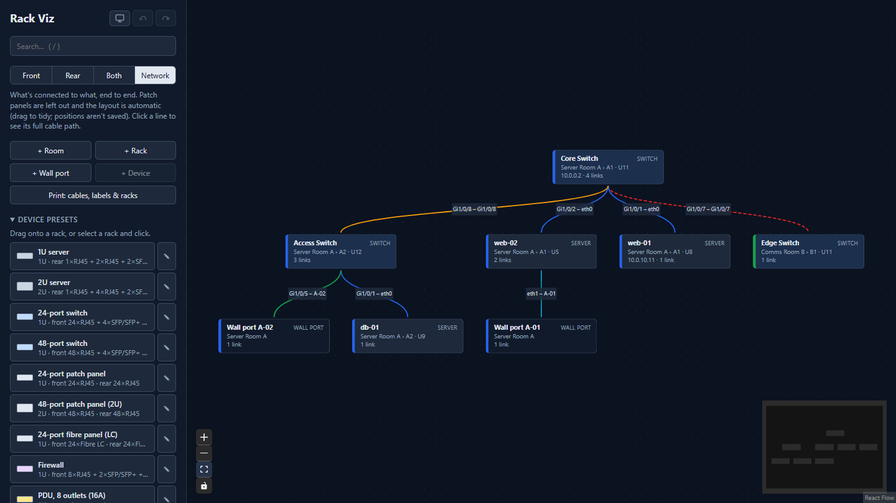

# Rack Viz

Plan and document server rooms: rooms, racks, devices, ports, cables, wall ports,
power, VLANs and attachments, edited in the browser and stored in a YAML file.



| Rack view | Network view |
| --- | --- |
|  |  |

The rack view shows each room and rack with devices at their U positions and the
cables between their ports; switch between front, rear or both faces. The network
view leaves out patch panels to show what connects to what end to end, and clicking
a line shows its full cable path.

## Running it

```
bun install
bun dev        # API on :3001 and the web app on :5173
```

Data lives in `data/` (`site.yaml`, `backups/`, `attachments/`). Set `DB_FILE`
to use a different file.

## Layout

```
shared/          Types and logic used by both the browser and the server
                 (schema, ports, cable tracing, schedule, power, VLANs, presets).
                 Import it as "#shared/<file>" from anywhere.
server/
  index.ts       Starts Express
  routes.ts      The /api routes
  attachments.ts Uploading, compressing and cleaning up attached files
  store/         The YAML database, undo/redo, backups, seed data, integrity rules
  csv/           CSV parsing, import and export
src/
  main.tsx, App.tsx, index.css
  app/           Site state, API client, app context, theme
  canvas/        The React Flow diagram: graph building, layout, routing, nodes, edges
  sidebar/       The sidebar and its editing forms
  search/  history/  csv/  print/  power/  vlans/  attachments/
                 One folder per feature
```

`#shared/*` is set up in `package.json` under `"imports"`, so it works the same in
Vite, TypeScript and the server (tsx/Node) with no extra config.