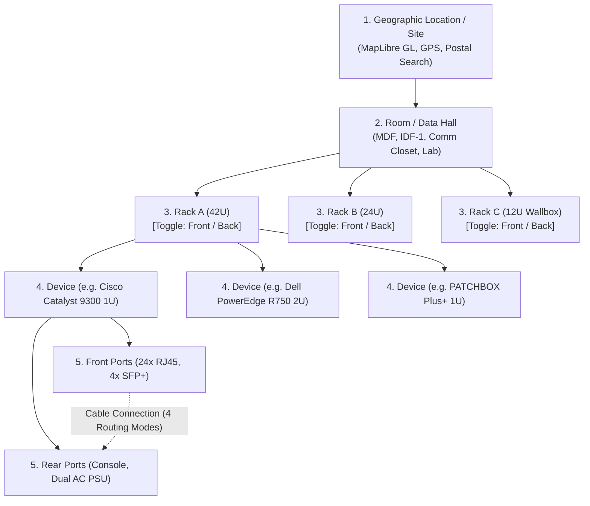
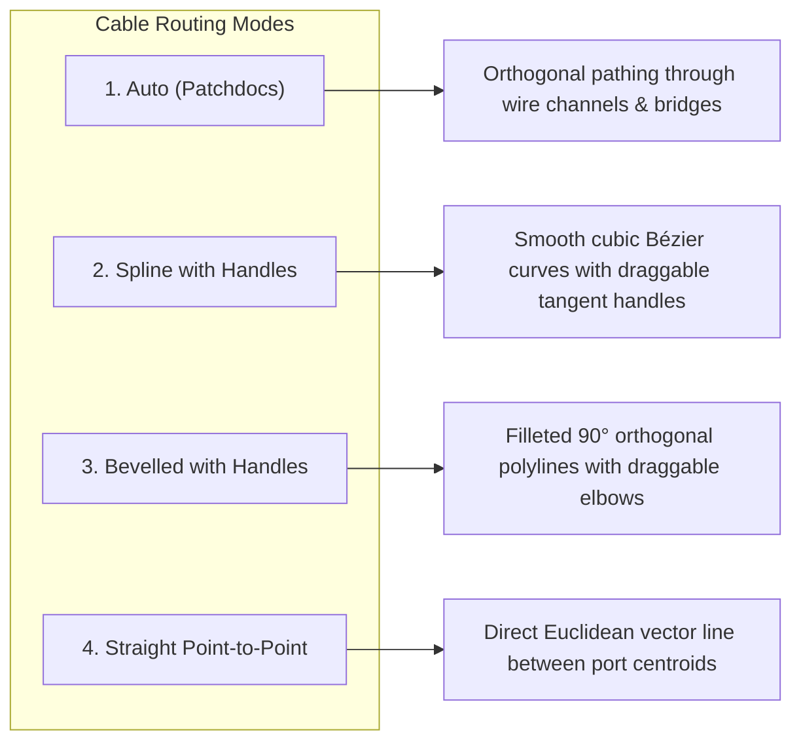
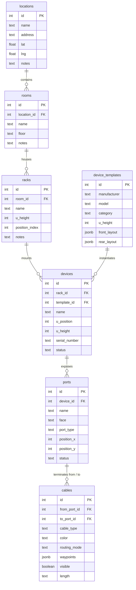

# Rackie — Product & Technical Architecture Specification
## Digital Twin Infrastructure & Cable Management Platform (Patchdocs-Inspired)

**Date:** 2026-09-10  
**Status:** Ready for Review  
**Author:** Pair Programming Assistant & User  
**System:** Rackie (Data Center, Server Room & Patch Management Digital Twin)  
**Inspiration:** [app.patchdocs.io](https://app.patchdocs.io) by PATCHBOX  

---

## 1. Executive Summary & Vision

**Rackie** is a next-generation visual IT infrastructure and patch management application. Moving beyond basic asset spreadsheets and static diagrams, Rackie creates a live **digital twin** of physical IT environments across the complete operational hierarchy:
$$\text{Locations (GIS/Map)} \longrightarrow \text{Rooms (MDF/IDF/Data Halls)} \longrightarrow \text{Racks (Variable U-Height)} \longrightarrow \text{Devices (Dual-Face)} \longrightarrow \text{Ports (Interactive Glyphs)}$$

Rackie delivers an interactive, high-fidelity visual room canvas where multiple server racks stand side-by-side. Technicians and network engineers can independently toggle each rack between **Front** and **Rear** elevation views, model patch cabling with **four distinct routing engines** (Auto, Spline with handles, Bevelled with handles, and Straight Point-to-Point), and build custom hardware using a modular **Device Library** inspired by `app.patchdocs.io`.

---

## 2. Information Architecture & Hierarchy

Rackie organizes physical infrastructure into five strictly typed tiers:



### Hierarchy Breakdown:
1. **Locations (`locations`)**: Geographic sites with physical addresses, GPS coordinates, interactive map pins, and site-level telemetry.
2. **Rooms (`rooms`)**: Physical enclosures or data halls within a location (e.g. "Main Server Room", "Basement MDF", "Floor 2 Comm Closet"). Each room possesses its own floor canvas.
3. **Racks (`racks`)**: Equipment enclosures located inside a room. Supports variable heights (**12U, 18U, 24U, 36U, 42U, 45U, 48U**). Every rack maintains independent state for **Front View** vs. **Rear View**.
4. **Devices (`devices`)**: Hardware mounted in racks occupying specific unit slots (`u_position`, `u_height`). Linked to reusable **Device Library Templates** (`device_templates`).
5. **Ports (`ports`)**: Addressable physical interfaces on devices. Defined by face (`front` or `rear`), port type (RJ45, SFP+, Fiber LC, C13/C14, Console, etc.), coordinates, and operational state.
6. **Cables (`cables`)**: Point-to-point connections between any two ports across any racks in the room, with configurable routing modes, colors, lengths, and visibility settings.

---

## 3. Interactive Room & Rack Elevation Visualizer

### 3.1 Room Elevation Canvas
The room canvas renders all racks belonging to a selected room side-by-side in a responsive SVG/HTML5 viewport with pan and zoom capabilities.

```
+---------------------------------------------------------------------------------------------------+
| Room: Main MDF (Floor 1)                 [Zoom: 100%] [Mode: Spline] [Cables: Active Only] [+ Add Rack] |
+---------------------------------------------------------------------------------------------------+
|  +--------------------+   +--------------------+   +--------------------+                         |
|  | Rack 01 (42U)      |   | Rack 02 (42U)      |   | Rack 03 (24U)      |                         |
|  | [ FRONT | back ]   |   | [ front | REAR ]   |   | [ FRONT | back ]   |                         |
|  +--------------------+   +--------------------+   +--------------------+                         |
|  | |42| [ Patch 24p ] |   | |42| [ PDU Horiz ] |   | |24| [ Blank     ] |                         |
|  | |41| [ Patch 24p ] |   | |41| [ Cable Org ] |   | |23| [ Switch 24p] |                         |
|  | |40| [ UniFi Agg ] |   | |40| [ Switch Rear]|   | |22| [ Server 1U ] |                         |
|  | |..|               |   | |..|               |   | |..|               |                         |
|  | |02| [ Dell R740 ] |   | |02| [ Server Dual]|   | |02| [ UPS 2U    ] |                         |
|  | |01| [ APC SmartUPS|   | |01| [ UPS Rear   ]|   | |01| [ UPS 2U    ] |                         |
|  +--------------------+   +--------------------+   +--------------------+                         |
|     (Cable Channel)          (Cable Channel)          (Cable Channel)                             |
+---------------------------------------------------------------------------------------------------+
```

### 3.2 Key Rack Capabilities
- **Independent Front / Back Toggle**:
  - Each rack has an independent segmented switch: `[ Front | Back ]`.
  - When toggled, the rack updates its displayed faceplate: devices render their front panel (network ports, LEDs, drive bays) or rear panel (power inlets, management ports, fans, serial console).
  - Crucial workflow: Enables connecting a cable from the **front** of Rack 01 (e.g. patch panel port 12) directly to the **rear** of Rack 02 (e.g. server secondary PSU or rear 10GbE NIC) on a single screen without mode switching.
- **Variable Rack Heights**:
  - Dynamic U-height calculation: Standard 1.75 inch (44.45mm) unit rendered at scalable pixel height (e.g. 24px per 1U).
  - Left and right rails display precision EIA-310-D square cage nut holes (3 holes per 1U) with visible U-slot boundary lines and numbered labels (1 to N, bottom-to-top or top-to-bottom).
- **Integrated Cable Management Channels**:
  - Each rack graphic incorporates left and right vertical wire channels (organizers / finger ducts) where auto-routed cables travel vertically.

---

## 4. Device Library & Creation Modal (Patchdocs-Style)

### 4.1 Device Library Catalog
Rackie provides a global catalog of pre-modeled hardware templates and a user library for custom equipment:
- **Preset Vendors**: Cisco, Juniper, Ubiquiti UniFi, Dell PowerEdge, HPE ProLiant, Fortinet, APC / Schneider, PATCHBOX Plus+, Amulet Hotkey (CoreStation / DXZ series), Panduit, Netgear.
- **Hardware Categories**:
  - Network Switches (1G, 10G SFP+, 25G/100G QSFP)
  - Routers & Firewalls
  - Patch Panels (Cat6 RJ45 24-port/48-port, Fiber LC Duplex 24-port)
  - Servers (1U, 2U, 4U rackmount chassis)
  - Power Distribution (1U/2U Horizontal PDUs, In-Rack UPS)
  - Cable Management & Accessories (PATCHBOX 1U retractable cassettes, 1U brush panels, blanking plates)

### 4.2 Device Creation Wizard (Modal Interface)
The modal allows users to build custom devices in under 2 minutes:

1. **Step 1: General Specs**:
   - Manufacturer & Model Name.
   - Category selection.
   - Form Factor: U-Height (1U to 8U), Depth (mm), Mounting type (Full depth, 2-post, wallbox).
   - Faceplate aesthetics: Color tone (dark graphite, brushed aluminium, matte black, enterprise blue), brand accent line.

2. **Step 2: Dual Faceplate Port Builder**:
   - Two interactive tabs: **Front Faceplate** and **Rear Faceplate**.
   - **Port Group Generator**:
     - *Quantity & Layout*: Add $N$ ports in 1 row or 2 rows (e.g., 24 ports as $2 \times 12$).
     - *Numbering scheme*: Odd-over-Even ($1, 3, 5\dots$ over $2, 4, 6\dots$) or Sequential ($1\dots 12$ over $13\dots 24$).
     - *Label Prefix*: `Gi1/0/`, `eth`, `Port `, `PSU`, `Console`.
     - *Port Type Selection* with live SVG preview.
   - Drag-and-drop port block repositioning along the $X$-axis of the 19" faceplate.

```
+---------------------------------------------------------------------------------------+
| Create Device Template — "Patchdocs Style"                                        [X] |
+---------------------------------------------------------------------------------------+
|  Manufacturer: [ Ubiquiti            ]   Model: [ USW-Pro-48-PoE        ]  Height: [1U]|
|  Category:     [ Network Switch      ]   Color: [ Brushed Silver       v]             |
+---------------------------------------------------------------------------------------+
|  [ FRONT FACEPLATE (Active) ]     [ REAR FACEPLATE ]                                  |
|                                                                                       |
|  Preview Faceplate (1U):                                                              |
|  +---------------------------------------------------------------------------------+  |
|  | [O] UniFi     [ [::] [::] [::] [::] [::] [::] ]  [ [::] [::] ]    [ [ ] [ ] [ ] [ ] ] |  |
|  |  Screen       Ports 1-24 (1G RJ45)               Ports 25-48      4x 10G SFP+       |  |
|  +---------------------------------------------------------------------------------+  |
|                                                                                       |
|  + Add Port Group:                                                                    |
|    Type: [ RJ45 Gigabit Ethernet  v]   Count: [ 48 ]   Layout: [ 2 Rows of 24      v]  |
|    Start Number: [ 1 ]   Prefix: [ Port ]   Numbering: [ Odd over Even (Standard) v]  |
|    [ + Insert Port Group ]                                                            |
+---------------------------------------------------------------------------------------+
|  [ Cancel ]                                                      [ Save to Library ]  |
+---------------------------------------------------------------------------------------+
```

---

## 5. Port Visual Specification & SVG Glyph Library

Every physical port is represented by an industry-standard SVG glyph with distinct pin geometry, socket latching, and interactive states (Available, Connected, Hovered, Disabled):

| Port Type | SVG Dimensions | Visual Characteristics & Detailing |
| :--- | :--- | :--- |
| **RJ45 (Ethernet)** | $14\text{px} \times 12\text{px}$ | 8P8C keyed tab notch at bottom, 8 gold contact pins at top, subtle metallic outer shield. |
| **SFP / SFP+ (10G)** | $16\text{px} \times 11\text{px}$ | Rectangular cage with optical transceiver latch bale slot and EMI ground spring fingers. |
| **QSFP / QSFP28 (40/100G)** | $20\text{px} \times 12\text{px}$ | Wider cage with dual optical guide rails and pull-tab latch recess. |
| **Fiber LC Duplex** | $14\text{px} \times 12\text{px}$ | Twin ceramic ferrule bores inside dual plastic clip latches with color-coded shroud (Aqua/OM4, Blue/OS2). |
| **Fiber SC Simplex/Duplex**| $14\text{px} \times 14\text{px}$ | Square push-pull latching mechanism with centered optical ferrule. |
| **Power C13 / C14** | $16\text{px} \times 14\text{px}$ | IEC 60320 trapezoidal shroud with 3 vertical/horizontal pin slots. |
| **Power C19 / C20** | $20\text{px} \times 15\text{px}$ | Heavy-duty rectangular shroud with 3 large horizontal flat pins (16A/20A). |
| **Console / Serial (RJ45/DB9)**| $14\text{px} \times 12\text{px}$ | Light blue RJ45 faceplate badge or mini D-sub trapezoid with terminal pins. |
| **USB Type-A / Type-C** | $12\text{px} \times 6\text{px}$ | Rectangular receptacle with internal plastic tongue / oval Type-C socket. |

### Port Interactive States:
- **Default / Unconnected**: Muted border with dark socket interior.
- **Hover**: Subtle neon glow (`box-shadow: 0 0 6px #422AFB`) displaying port tooltip (`"Port 24 (RJ45 1GbE) - Unpatched"`).
- **Patch Active**: Port glows bright green / brand color indicating it is the source of an in-progress cable patch.
- **Occupied / Connected**: Small colored plug indicator matching connected cable color, with click-to-trace interaction.

---

## 6. The 4-Mode Cable Routing Engine

Rackie implements **four dedicated routing algorithms** catering to diverse engineering workflows:



### 6.1 Mode 1: Auto (Patchdocs-Style Smart Routing)
- **Concept**: Emulates professional data center cable dressing. Cables exit the port, exit horizontally into the nearest vertical rack wire duct, travel vertically down or up the rack rails, cross between racks via an overhead cable ladder or under-floor bridge, and enter the destination port.
- **Algorithm**:
  1. Let $P_1 = (x_1, y_1)$ and $P_2 = (x_2, y_2)$ be source and target ports.
  2. Determine nearest rack channel $X_{\text{channel}, 1}$ (left or right side of Rack 1).
  3. Lead horizontal stub: $(x_1, y_1) \to (X_{\text{channel}, 1}, y_1)$.
  4. Vertical run: Travel vertically in channel to top raceway $Y_{\text{top}}$ or bottom raceway $Y_{\text{bottom}}$ (whichever yields shortest path).
  5. Horizontal bridge: Travel along raceway to target rack channel $X_{\text{channel}, 2}$.
  6. Destination entry: Travel vertically to $y_2$, then horizontally $(X_{\text{channel}, 2}, y_2) \to (x_2, y_2)$.
  7. Corner rounding: Apply SVG `arc` fillets with radius $r = 8\text{px}$ on all turns to avoid jagged corners.

### 6.2 Mode 2: Spline with Handles (Interactive Bézier Curves)
- **Concept**: Organic, fluid patch cables with realistic gravitational catenary curve slack and interactive curvature handles.
- **Mathematical Formulation**:
  - Cubic Bézier curve rendered via SVG path:
    $$\mathbf{B}(t) = (1-t)^3 P_0 + 3(1-t)^2 t P_1 + 3(1-t) t^2 P_2 + t^3 P_3, \quad t \in [0, 1]$$
    `d="M x0 y0 C cx1 cy1, cx2 cy2, x3 y3"`
  - Default control points $P_1 = (x_0, y_0 + \text{slack})$, $P_2 = (x_3, y_3 + \text{slack})$.
- **Interactive Tangent Handles**:
  - When a cable is selected, two draggable circular control handles appear at $(cx_1, cy_1)$ and $(cx_2, cy_2)$ with dashed tangent guide lines connecting back to the port anchors.
  - Users can drag handles to shape the loop, sweep cables around obstacles, or bundle cables neatly into harness groups.

### 6.3 Mode 3: Bevelled Lines with Handles (Manual Orthogonal Polylines)
- **Concept**: Clean CAD-style architectural schematics with 90-degree bends and bevelled/rounded chamfer corners, fully customizable via draggable elbow waypoint handles.
- **Path Generation & Waypoint Handles**:
  - Represented by an ordered list of waypoints: $[P_{\text{start}}, W_1, W_2, \dots, W_k, P_{\text{end}}]$.
  - SVG Path with rounded corners: At every corner vertex $W_i$, an arc fillet of radius $R = 10\text{px}$ is interpolated between the incoming vector $\vec{v}_{\text{in}}$ and outgoing vector $\vec{v}_{\text{out}}$.
  - When selected, draggable diamond-shaped handles appear on every waypoint $W_i$.
  - Midpoint "+" handles allow clicking on any segment to spawn a new orthogonal elbow, giving the user complete manual control over the cable path.

### 6.4 Mode 4: Straight Point-to-Point
- **Concept**: Minimalist direct Euclidean line connecting port centroids.
- **Rendering**: Clean SVG line or path: `d="M x1 y1 L x2 y2"` with optional center label displaying cable tag and length.
- **Use Case**: High-density cross-connect audits, high-altitude overview diagrams, and rapid connection tracing without visual clutter.

---

## 7. Cross-Rack, Cross-Face Connections & Visibility Management

A critical capability requested is connecting a port from the **front** of one rack to the **rear** of another rack (e.g. Front Patch Panel in Rack A $\to$ Rear Server NIC in Rack B).

### 7.1 The Face-Flipping Challenge & Solution
When Rack B is toggled to **Front View**, its rear ports are physically facing away and not visible on screen. If a cable connects to a hidden face:
1. **Ghost / Pass-Through Port Badges**:
   - The visible front face of the device displays a subtle "Rear-Connected" icon badge (e.g. $\odot$) on that slot.
   - Hovering over the badge renders a floating tooltip:
     `"Port connected to Rack 01 / Switch-01 / Port 12 (Front). Toggle this rack to REAR to view cable path."`
2. **Cable Visibility Filtering**:
   - The canvas toolbar provides a three-way visibility filter:
     - **Active View Only (Default)**: Cables only render their full paths if *both* endpoint ports are currently visible on their respective racks. Avoids cables ending abruptly in mid-air.
     - **Show Selected / Traced Cable**: Clicking any port or cable row in the table isolates and renders that specific cable path across racks, rendering a dashed line through the rack frame if the endpoint is on the rear face.
     - **Show All (with Translucent Pass-Throughs)**: Renders all cables, with dashed translucent lines (`stroke-dasharray="4 4"`, opacity $0.35$) for segments leading to hidden faces.
3. **Per-Cable Visibility Toggle**:
   - Each cable row in the Connections Manager drawer contains an eye icon toggle (`visible: true/false`). Technicians can hide specific trunk bundles to focus on a particular circuit.

---

## 8. Database Architecture & Schema Migrations

The database will be expanded beyond the initial `locations` table to support the complete relational hierarchy:



### 8.1 PostgreSQL Migration Scripts

```sql
-- 1. Rooms Table
CREATE TABLE rooms (
  id           serial PRIMARY KEY,
  location_id  integer NOT NULL REFERENCES locations(id) ON DELETE CASCADE,
  name         text NOT NULL,
  floor        text,
  notes        text,
  created_at   timestamptz NOT NULL DEFAULT now(),
  updated_at   timestamptz NOT NULL DEFAULT now()
);
CREATE INDEX idx_rooms_location_id ON rooms(location_id);

-- 2. Racks Table
CREATE TABLE racks (
  id              serial PRIMARY KEY,
  room_id         integer NOT NULL REFERENCES rooms(id) ON DELETE CASCADE,
  name            text NOT NULL,
  u_height        integer NOT NULL DEFAULT 42 CHECK (u_height > 0 AND u_height <= 60),
  position_index  integer NOT NULL DEFAULT 0,
  notes           text,
  created_at      timestamptz NOT NULL DEFAULT now(),
  updated_at      timestamptz NOT NULL DEFAULT now()
);
CREATE INDEX idx_racks_room_id ON racks(room_id);

-- 3. Device Templates (Global & Custom Device Library)
CREATE TABLE device_templates (
  id            serial PRIMARY KEY,
  manufacturer  text NOT NULL,
  model         text NOT NULL,
  category      text NOT NULL,
  u_height      integer NOT NULL DEFAULT 1,
  color         text DEFAULT '#2D3748',
  front_layout  jsonb NOT NULL DEFAULT '[]'::jsonb,
  rear_layout   jsonb NOT NULL DEFAULT '[]'::jsonb,
  is_preset     boolean NOT NULL DEFAULT false,
  created_at    timestamptz NOT NULL DEFAULT now(),
  updated_at    timestamptz NOT NULL DEFAULT now()
);

-- 4. Deployed Devices in Racks
CREATE TABLE devices (
  id             serial PRIMARY KEY,
  rack_id        integer NOT NULL REFERENCES racks(id) ON DELETE CASCADE,
  template_id    integer REFERENCES device_templates(id) ON DELETE SET NULL,
  name           text NOT NULL,
  u_position     integer NOT NULL CHECK (u_position >= 1),
  u_height       integer NOT NULL CHECK (u_height >= 1),
  serial_number  text,
  status         text NOT NULL DEFAULT 'online',
  notes          text,
  created_at     timestamptz NOT NULL DEFAULT now(),
  updated_at     timestamptz NOT NULL DEFAULT now(),
  CONSTRAINT u_slot_fit CHECK (u_position + u_height - 1 <= 60)
);
CREATE INDEX idx_devices_rack_id ON devices(rack_id);

-- 5. Individual Ports
CREATE TYPE port_face AS ENUM ('front', 'rear');

CREATE TABLE ports (
  id           serial PRIMARY KEY,
  device_id    integer NOT NULL REFERENCES devices(id) ON DELETE CASCADE,
  name         text NOT NULL,                 -- e.g. "Port 1", "Gi1/0/24", "PSU-1"
  face         port_face NOT NULL,
  port_type    text NOT NULL,                 -- 'rj45', 'sfp_plus', 'fiber_lc', 'c14', etc.
  pos_x        double precision NOT NULL,     -- normalized 0.0 - 1.0 along faceplate
  pos_y        double precision NOT NULL,     -- normalized 0.0 - 1.0 along faceplate
  status       text NOT NULL DEFAULT 'active',
  created_at   timestamptz NOT NULL DEFAULT now()
);
CREATE INDEX idx_ports_device_id ON ports(device_id);

-- 6. Cables (Patch Connections)
CREATE TYPE cable_routing_mode AS ENUM ('auto', 'spline', 'bevelled', 'straight');

CREATE TABLE cables (
  id            serial PRIMARY KEY,
  from_port_id  integer NOT NULL REFERENCES ports(id) ON DELETE CASCADE,
  to_port_id    integer NOT NULL REFERENCES ports(id) ON DELETE CASCADE,
  cable_type    text NOT NULL DEFAULT 'cat6',
  color         text NOT NULL DEFAULT '#3182CE',  -- hex color code
  routing_mode  cable_routing_mode NOT NULL DEFAULT 'auto',
  waypoints     jsonb NOT NULL DEFAULT '[]'::jsonb, -- custom handle coordinates for spline/bevelled
  visible       boolean NOT NULL DEFAULT true,
  length        text,                             -- e.g. "1.5m", "3m"
  label         text,                             -- e.g. "VLAN-100-UPLINK"
  created_at    timestamptz NOT NULL DEFAULT now(),
  updated_at    timestamptz NOT NULL DEFAULT now(),
  CONSTRAINT chk_different_ports CHECK (from_port_id <> to_port_id)
);
CREATE INDEX idx_cables_from_port ON cables(from_port_id);
CREATE INDEX idx_cables_to_port ON cables(to_port_id);
```

---

## 9. REST API Specification

| Method | Endpoint | Description |
| :--- | :--- | :--- |
| `GET` | `/api/locations/:id/rooms` | List all rooms for a specific location. |
| `POST` | `/api/locations/:id/rooms` | Create a new room at a location. |
| `GET` | `/api/rooms/:id` | Fetch room details, including all racks, devices, and cables. |
| `POST` | `/api/rooms/:id/racks` | Add a rack to a room (`name`, `u_height`, `position_index`). |
| `PUT` | `/api/racks/:id` | Update rack details (rename, resize U-height, reorder). |
| `DELETE` | `/api/racks/:id` | Delete a rack and cascade devices/cables. |
| `GET` | `/api/device-templates` | Get device library templates (system presets + user created). |
| `POST` | `/api/device-templates` | Save a new custom device template to the library. |
| `POST` | `/api/racks/:id/devices` | Mount a device in a rack (assign slot `u_position`, template, name). |
| `PUT` | `/api/devices/:id` | Move device slot, update specs, serial number, status. |
| `DELETE` | `/api/devices/:id` | Unmount device from rack. |
| `GET` | `/api/rooms/:id/cables` | List all patch cables within a room. |
| `POST` | `/api/cables` | Create a patch connection (`from_port_id`, `to_port_id`, `color`, `routing_mode`, `waypoints`). |
| `PUT` | `/api/cables/:id` | Update cable routing mode, waypoints, color, or visibility. |
| `DELETE` | `/api/cables/:id` | Remove a patch cable. |

---

## 10. Frontend Canvas Architecture & Interaction Design

### 10.1 Component Architecture
```
src/
├── components/
│   ├── rack/
│   │   ├── RoomCanvas.jsx          # Top-level SVG + HTML interactive room container
│   │   ├── RackElevation.jsx       # SVG rack frame, U rails, cage nuts, and Front/Back toggle
│   │   ├── DeviceFaceplate.jsx     # Renders front/rear modular device panel in slot
│   │   └── PortNode.jsx            # Interactive port SVG glyph (RJ45, SFP, etc.) with hitboxes
│   ├── cables/
│   │   ├── CableOverlay.jsx        # SVG layer floating over racks rendering all cables
│   │   ├── AutoCablePath.jsx       # Manhattan wire-channel orthogonal path generator
│   │   ├── SplineCablePath.jsx     # Cubic Bézier path with interactive control handles
│   │   ├── BevelledCablePath.jsx   # Chamfered polyline path with elbow waypoint handles
│   │   ├── StraightCablePath.jsx   # Direct Euclidean line path
│   │   └── CableToolbar.jsx        # Mode switcher, color picker, visibility filters
│   └── deviceLibrary/
│       ├── DeviceLibraryModal.jsx  # Patchdocs-style template library + custom creator
│       ├── FaceplateEditor.jsx     # Interactive port-group faceplate builder
│       └── PortGlyphPicker.jsx     # Port type visual selector
```

### 10.2 Coordinate Transformation & Dynamic Patching
- Port nodes register their live bounding client rects or SVG local matrices with a centralized Canvas Coordinate Store.
- When an engineer clicks an available Port $A$:
  1. The canvas enters `PatchDrafting` mode.
  2. A live elastic rubber-band cable follows the mouse cursor from Port $A$ centroid.
  3. Eligible destination ports highlight with a pulsing connection indicator.
  4. Clicking valid Port $B$ creates the patch connection in the database and renders the chosen routing path.
- When a rack is toggled between Front and Back, the coordinate engine recalculates the visible anchor endpoints immediately.

---

## 11. Phased Implementation Roadmap

### Phase 1: Database Expansion & Core Backend APIs
- Run migration creating `rooms`, `racks`, `device_templates`, `devices`, `ports`, and `cables`.
- Implement Express route modules and repositories with Jest integration test suite.
- Seed database with standard device library presets (Cisco Catalyst 9300, Dell PowerEdge R740, UniFi Switch Pro 48, PATCHBOX Plus+ 1U).

### Phase 2: Variable-Height SVG Rack & Independent Front/Back Toggles
- Build `RackElevation.jsx` supporting variable heights (12U, 18U, 24U, 42U, 48U).
- Build the independent `[Front | Back]` toggle switch per rack.
- Build multi-rack room visualizer displaying side-by-side racks.

### Phase 3: Device Library Modal & Port SVG Glyph Library
- Build the Patchdocs-style Device Creation Modal with dual faceplate tabs and port group generator.
- Implement comprehensive SVG glyphs for RJ45, SFP+, Fiber LC, C13/C14, Console, and USB.
- Drag-and-drop mounting of library devices into rack U-slots.

### Phase 4: The 4-Mode Cable Routing Engine
- Implement SVG `CableOverlay` with the four distinct modes:
  1. **Auto**: Algorithmic obstacle avoidance through rack channels.
  2. **Spline with Handles**: Draggable Bézier tangent controls.
  3. **Bevelled with Handles**: Chamfered orthogonal lines with elbow waypoints.
  4. **Straight Point-to-Point**: Direct lines.
- Implement cross-rack and cross-face connections with hidden-face ghost badges and visibility filtering.

### Phase 5: UI Polish & Legacy Horizon Cleanup
- Replace remaining Horizon UI template artifacts with Rackie branding.
- Add room switcher to dashboard and link map location pins to room views.
